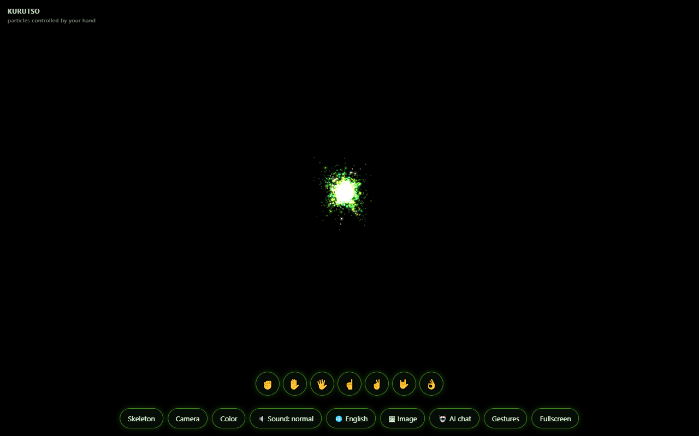

# KURUTSO

Hand-controlled 3D particle show in a single HTML file.

720 particles follow your hand via webcam: fist = sphere, open hand = ring, pinch = vortex, point = comet, peace = rain, rock = storm, five fingers = corners. Two hands split the swarm. Includes AI chat (bring your own free Gemini key) that draws any shape with particles, image-to-particle contour drawing, 5 languages, themes, sound, and a mouse/touch fallback. No install, no build step.

## Demo

The source file is delivered after purchase (single `kurutso.html`, ~120 KB). Serve it over HTTPS/localhost for camera mode, or open locally. Without a camera: mouse + keys 1–7 (desktop) or finger + gesture buttons (mobile).

## License / purchase
- Usage license: **$5** — use in personal & commercial projects; no source resale.
- Full copyright buyout: **$121** — complete source + transfer of economic rights; rebrand & resell allowed.

Contact the author to purchase (see seller profile / listing links).

## Requirements
Camera mode: HTTPS or localhost, camera permission, internet (hand model CDN). AI mode: free Gemini API key from aistudio.google.com.